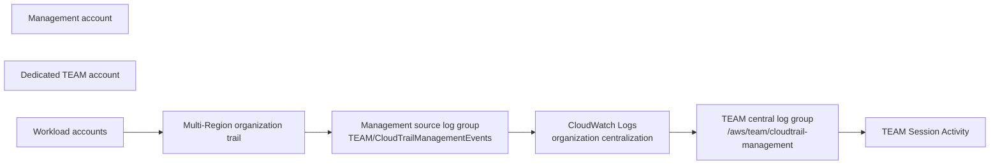

# Temporary Elevated Access Management (TEAM) for AWS IAM Identity Center

TEAM is an open-source application for requesting, approving, granting, and revoking time-bound elevated access through AWS IAM Identity Center.

This branch installs TEAM with **CloudWatch unified session activity**. It uses a management-account multi-Region organization trail, CloudWatch Logs centralization into a dedicated TEAM account, and CloudWatch Logs Insights for the Session Activity UI. It does not require a new CloudTrail Lake event data store.

> Do not deploy this CloudWatch-backed installation over an existing TEAM deployment that owns a CloudTrail Lake event data store. Keep the existing deployment intact and use a fresh namespace and stacks for the CloudWatch installation.

## Architecture



`ORGANIZATION_TRAIL_HOME_REGION` is the **single** Region that contains the multi-Region organization trail and its CloudWatch Logs source group. The trail still collects events from all organization accounts and Regions. CloudWatch Logs centralization copies that one source group to the TEAM account.

## Accounts and responsibilities

| Account | Responsibilities |
| --- | --- |
| Management | AWS Organizations, IAM Identity Center, CloudTrail trusted access, the multi-Region organization trail, its S3 archive, its CloudWatch Logs source group, and its delivery role. |
| TEAM | TEAM application, IAM Identity Center and CloudWatch delegated administration, central log group, centralization rule, SSM audit parameters, Amplify, Cognito, AppSync, and Lambdas. |
| Workload | Target accounts for temporary access. The organization trail collects their management events. |

Do not deploy the TEAM application in the management account.

## Prerequisites

- An AWS Organization with IAM Identity Center in the selected home Region.
- A dedicated TEAM account and one or more workload accounts.
- AWS CLI, Git, `git-remote-codecommit`, and `jq`.
- Named AWS CLI profiles for both the management and TEAM accounts.
- IAM Identity Center permission sets for the workload accounts. TEAM does not grant temporary access to the management account.
- Separate requester and approver identities. TEAM prevents requesters from approving their own requests.

Create IAM Identity Center groups before deployment:

- `TEAM-<environment>-Pilot`
- `TEAM-<environment>-Admins`
- `TEAM-<environment>-Auditors`
- Optional requester group

## Configure deployment parameters

```sh
git clone https://github.com/aws-samples/iam-identity-center-team.git
cd iam-identity-center-team/deployment
cp parameters-template.sh parameters.sh
```

`parameters.sh` is ignored by Git. It must contain profile names and configuration values only, never credentials.

Example for a CloudWatch unified installation in `eu-central-1`:

```sh
IDC_LOGIN_URL=https://d-<identity-store-id>.awsapps.com/start
REGION=eu-central-1

TEAM_ACCOUNT=<team-account-id>
ORG_MANAGEMENT_PROFILE=<management-profile>
TEAM_ACCOUNT_PROFILE=<team-profile>

TEAM_ADMIN_GROUP=TEAM-Test-Admins
TEAM_AUDITOR_GROUP=TEAM-Test-Auditors
TAGS="project=iam-identity-center-team environment=pilot"

ORGANIZATION_ID=o-<organization-id>

# One Region: the multi-Region organization trail home Region.
ORGANIZATION_TRAIL_HOME_REGION=eu-central-1
AUDIT_SOURCE_RETENTION_DAYS=1
AUDIT_CENTRAL_RETENTION_DAYS=7
AUDIT_CENTRAL_KMS_KEY_ARN=""

# TEAM centralization selects the management trail source group.
CENTRALIZATION_SOURCE_LOG_GROUP_SELECTION_CRITERIA="LogGroupName LIKE 'TEAM/CloudTrail%'"
AUDIT_STACK_NAME=TEAM-CLOUDWATCH-AUDIT-<namespace>

# Management-account organization-trail stack.
ORGANIZATION_TRAIL_STACK_NAME=TEAM-ORGANIZATION-AUDIT-<namespace>
ORGANIZATION_TRAIL_SOURCE_LOG_GROUP_NAME=TEAM/CloudTrailManagementEvents

TEAM_DEPLOYMENT_NAMESPACE=<namespace>
```

Use a unique namespace for every parallel installation. It names the TEAM application stack, CodeCommit repository, Amplify branch, Cognito environment, and AppSync backend.

### Choose the audit source mode

Set one of these values in `parameters.sh`:

```sh
# TEAM creates and owns the management-account trail.
AUDIT_SOURCE_MODE=managed-organization-trail

# Customer keeps ownership of an existing trail.
AUDIT_SOURCE_MODE=existing-trail
```

For `existing-trail`, set the existing trail owner, source group, and source Region:

```sh
EXISTING_TRAIL_NAME=<customer-organization-trail-name>
EXISTING_TRAIL_OWNER_PROFILE=<local-aws-cli-profile-for-trail-owner>
EXISTING_TRAIL_OWNER_ACCOUNT_ID=<trail-owner-account-id>
EXISTING_TRAIL_SOURCE_LOG_GROUP_NAME=<customer-source-log-group-name>
EXISTING_TRAIL_SOURCE_LOG_GROUP_REGION=<trail-home-region>
EXISTING_TRAIL_CLOUDWATCH_ROLE_NAME=TEAMExistingTrailCloudWatchLogsDelivery

ORGANIZATION_TRAIL_HOME_REGION=<trail-home-region>
CENTRALIZATION_SOURCE_LOG_GROUP_SELECTION_CRITERIA="LogGroupName LIKE '<approved-source-prefix>%'"
```

## Installation sequence

### 1. Enable CloudTrail trusted access manually

Run this once from the management account before deploying the management trail stack:

```sh
aws organizations enable-aws-service-access \
  --profile "${ORG_MANAGEMENT_PROFILE}" \
  --service-principal cloudtrail.amazonaws.com
```

The management-account organization trail owns its CloudWatch Logs delivery role. A TEAM CloudTrail delegated administrator is not required for this architecture.

### 2. Bootstrap TEAM delegated administration

Inspect first:

```sh
./init.sh
```

Review the result, then apply the approved organization-level changes:

```sh
./init.sh --apply
```

This configures delegated administration for Account Management, IAM Identity Center, and CloudWatch telemetry. It also verifies the AWS Config service-linked role and telemetry evaluation state.

Do not proceed while telemetry evaluation is in a failed state.

### 3. Deploy the TEAM centralization stack

Create and review the unexecuted change set:

```sh
./cloudwatch-audit/deploy.sh
```

Apply it after review:

```sh
./cloudwatch-audit/deploy.sh --apply
```

This stack is deployed in the TEAM account. It creates:

- `/aws/team/cloudtrail-management`
- The organization centralization rule that selects `TEAM/CloudTrail%`
- The audit SSM parameters `/team/audit/log-group-arn` and `/team/audit/region`
- The CloudWatch telemetry rule retained by the current stack

The TEAM central log group has seven-day retention, deletion protection, and retain policies.

### 4. Configure the audit trail source

#### TEAM-managed organization trail

Use this path when TEAM should create the management-account trail. Create and review the unexecuted change set:

```sh
./cloudwatch-audit/deploy-organization-trail.sh
```

Apply it after review:

```sh
./cloudwatch-audit/deploy-organization-trail.sh --apply
```

This stack is deployed in the management account. It creates:

- A multi-Region organization trail for management events
- `TEAM/CloudTrailManagementEvents` in the trail home Region
- A private, versioned S3 archive bucket
- A management-account CloudTrail-to-CloudWatch Logs delivery role

#### Existing customer trail

Use this path when the customer already owns an organization trail. Do not run `deploy-organization-trail.sh` in `existing-trail` mode.

First inspect the supplied trail without changing it:

```sh
./cloudwatch-audit/configure-existing-trail.sh
```

The script verifies the trail owner, organization-trail status, multi-Region status, current CloudWatch Logs configuration, and source group settings.

To let TEAM configure CloudWatch Logs delivery automatically, obtain explicit customer approval for the named trail and run:

```sh
./cloudwatch-audit/configure-existing-trail.sh --apply
```

`--apply` creates the declared source log group and CloudTrail delivery role only when absent, applies the declared source retention, updates only the existing trail's `CloudWatchLogsLogGroupArn` and `CloudWatchLogsRoleArn`, then starts logging. It does not change the trail's S3 destination, event selectors, data-event coverage, ownership, or retention.

If the customer configures the trail themselves, they must create a source group in the trail-owner account and the declared source Region, create a CloudTrail delivery role in that same account with `logs:CreateLogStream` and `logs:PutLogEvents` scoped to the source group, configure those two values on the existing trail, and start logging. They then provide the exact source group name and Region in `parameters.sh`. The source group must not use the reserved `aws/` prefix.

For either mode, CloudTrail events created before CloudWatch Logs delivery starts are not backfilled.

### 5. Deploy the namespaced TEAM application

```sh
./deploy.sh --apply
```

The application stack resolves the fixed SSM audit parameters at deployment time and supplies the central group ARN and Region to the query Lambdas. If those SSM values change later, update the application stack before relying on the new values.

### 6. Configure the IAM Identity Center SAML application manually

Run:

```sh
./integration.sh
```

In the IAM Identity Center console, create a **custom SAML 2.0 application** using the generated values:

- Application start URL: `application_start_url`
- ACS URL: `application_acs_url`
- SAML audience: `application_saml_audience`

Add these exact mappings:

```text
Subject  = ${user:subject}  persistent
Email    = ${user:email}    basic
```

`Email` is case-sensitive. Do not use `EMail`.

Assign only the pilot group to the SAML application, for example `TEAM-Test-Pilot`. Administrators and auditors still need membership in their corresponding Identity Center groups for in-application authorization.

Copy the IAM Identity Center SAML metadata URL into `deployment/details.json`:

```json
{
  "MetadataURL": "https://portal.sso.<region>.amazonaws.com/saml/metadata/..."
}
```

Then configure Cognito:

```sh
./cognito.sh --apply
```

## Validation

Before admitting pilot users:

1. Confirm anonymous AppSync requests are denied with HTTP 401.
2. Sign in through the pilot SAML application and verify the expected TEAM role.
3. Create an eligibility policy and an approver policy for a workload account.
4. Create a request as one user and approve it as a separate user.
5. Perform a new management action through the approved elevated session.
6. Verify the same CloudTrail `eventID` in both:
   - Management: `TEAM/CloudTrailManagementEvents`
   - TEAM: `/aws/team/cloudtrail-management`
7. Open Session Activity for the new request and verify that the event is visible.
8. Verify CSV download in the supported browser.

Do not use a request created before the management organization trail started. Those earlier events cannot appear in the new source or central log groups.

## Updating or removing the installation

- `./update.sh --apply` updates only the namespaced TEAM application.
- Manage the management trail and TEAM centralization stacks independently through their respective deployment scripts.
- Do not delete the management trail, its source group, or the TEAM central group as part of normal application removal.
- Deleting retained trail buckets or log groups requires explicit approval and separate cleanup.

## Additional documentation

- [Deployment documentation](https://aws-samples.github.io/iam-identity-center-team/docs/deployment/)
- [Architecture and workflows](https://aws-samples.github.io/iam-identity-center-team/docs/overview/)
- [User guides](https://aws-samples.github.io/iam-identity-center-team/docs/guides/)
- [Temporary Elevated Access Management blog post](https://aws.amazon.com/blogs/security/temporary-elevated-access-management-with-iam-identity-center/)

## Security

See [CONTRIBUTING](CONTRIBUTING.md#security-issue-notifications) for security reporting information.

## License

This library is licensed under the MIT-0 License. See [LICENSE](LICENSE).

## Disclaimer

The sample code, software libraries, command line tools, proofs of concept, templates, or related technology are provided as AWS Content under the AWS Customer Agreement or the relevant written agreement. You are responsible for testing, securing, and optimizing the content for your environment. Deploying AWS Content can incur AWS charges for resources such as CloudTrail, CloudWatch Logs, Amazon S3, and AWS Identity Center.
