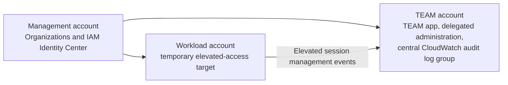

# Clean CloudWatch-backed TEAM test environment

This guide prepares an isolated multi-account test environment for the CloudWatch-backed TEAM deployment. It follows the repository deployment documentation and incorporates validation points discovered during the pilot.

Use a **new AWS Organization**, not merely new accounts in the existing organization. IAM Identity Center delegation and CloudWatch telemetry configuration are organization-wide.



## 1. Create the account structure

Create these accounts in the new organization:

| Account | Purpose |
| --- | --- |
| Management | AWS Organizations and IAM Identity Center only. Do not deploy TEAM here. |
| TEAM | Dedicated TEAM application, delegated administration, and central audit logs. |
| Workload | Target for temporary elevated-access requests and audit tests. |

Optionally add a second workload account in a child OU to test OU-scoped eligibility and approver policies.

Use one Region throughout the initial test, for example `eu-central-1`. IAM Identity Center, TEAM, central logs, and the workload account should use that Region.

## 2. Prepare IAM Identity Center

In the management account:

1. Enable IAM Identity Center in the selected Region.
2. Create a least-privilege test permission set for the workload account. TEAM cannot grant temporary access to the management account.
3. Create these groups:
   - `TEAM-Test-Pilot`
   - `TEAM-Test-Admins`
   - `TEAM-Test-Auditors`
   - Optional: `TEAM-Test-Requesters`
   - `TEAM-Test-PermissionSet-Provisioning`, with no members
4. Create at least two separate users:
   - **Requester**: member of `TEAM-Test-Pilot` and `TEAM-Test-Requesters`.
   - **Approver/admin**: member of `TEAM-Test-Pilot`, `TEAM-Test-Admins`, and `TEAM-Test-Auditors`.
5. Pre-provision the test permission set in the workload account:
   1. In IAM Identity Center, choose **AWS accounts** and select the workload account.
   2. Choose **Assign users or groups**.
   3. Select the empty `TEAM-Test-PermissionSet-Provisioning` group.
   4. Select the test permission set and submit the assignment.

IAM Identity Center provisions a permission set to an account through a user or group assignment; it has no standalone "assign permission set to account" action. Keep the provisioning group empty so no user receives permanent access through this initial assignment. Do not assign the test permission set directly to the requester or approver groups.

Keep requester and approver identities separate. TEAM excludes the requester from the approval queue.

## 3. Prepare the workstation and source

Install or configure:

- AWS CLI
- `git`
- `git-remote-codecommit`
- `jq`
- Named AWS CLI profiles for the management and TEAM accounts

Clone into a fresh directory and use a distinct test branch. Do not deploy over an existing CloudTrail Lake-backed TEAM stack.

```sh
git clone https://github.com/aws-samples/iam-identity-center-team.git
cd iam-identity-center-team
git checkout -b test/cloudwatch-clean
cd deployment
cp parameters-template.sh parameters.sh
```

`parameters.sh` is ignored by Git. Store profile names and deployment values only, never credentials.

## 4. Configure `deployment/parameters.sh`

Use a unique namespace, such as `cwclean`, so all generated resources are isolated.

```sh
IDC_LOGIN_URL=https://d-<identity-store-id>.awsapps.com/start
REGION=eu-central-1

TEAM_ACCOUNT=<team-account-id>
ORG_MANAGEMENT_PROFILE=<management-profile>
TEAM_ACCOUNT_PROFILE=<team-profile>

TEAM_ADMIN_GROUP=TEAM-Test-Admins
TEAM_AUDITOR_GROUP=TEAM-Test-Auditors

TAGS="project=iam-identity-center-team environment=clean-test"
CACHE_TTL=604800

ORGANIZATION_ID=o-<new-organization-id>
ORGANIZATION_TRAIL_HOME_REGION=eu-central-1
AUDIT_SOURCE_RETENTION_DAYS=1
AUDIT_CENTRAL_RETENTION_DAYS=7
AUDIT_CENTRAL_KMS_KEY_ARN=
AUDIT_STACK_NAME=TEAM-CLOUDWATCH-AUDIT-cwclean

TEAM_DEPLOYMENT_NAMESPACE=cwclean
```

## 5. Bootstrap the organization

Inspect first:

```sh
./init.sh
```

Review the output, then apply only after confirming the new organization and TEAM account IDs:

```sh
./init.sh --apply
```

This configures delegated administration for Account Management, IAM Identity Center, and CloudWatch telemetry. It also ensures the management account has `AWSServiceRoleForConfig` and waits for CloudWatch telemetry evaluation to reach `RUNNING`.

Before continuing, verify the TEAM account is registered as delegated administrator for both:

- `sso.amazonaws.com`
- `observabilityadmin.amazonaws.com`

The IAM Identity Center registration is required for the application to list permission sets.

## 6. Deploy the independent audit stack

Create an unexecuted change set:

```sh
./cloudwatch-audit/deploy.sh
```

Review the destination account, source Region, retention, and the resource scope. Then apply the reviewed stack:

```sh
./cloudwatch-audit/deploy.sh --apply
```

Validate:

- The stack reaches `CREATE_COMPLETE`.
- Termination protection is enabled.
- Systems Manager parameters exist:
  - `/team/audit/log-group-arn`
  - `/team/audit/region`
- The centralization rule reports `Healthy`.
- The telemetry rule is present.

Do not treat rule health as proof that events are flowing. Require source logs and central-log events before declaring audit ingestion ready.

## 7. Deploy the namespaced TEAM application

```sh
./deploy.sh --apply
```

This creates a separate stack, CodeCommit repository, Amplify application, Cognito user pool, AppSync API, and backend environment using the `cwclean` namespace.

Wait for the Amplify build to succeed.

## 8. Create the pilot SAML application

Generate the SAML values:

```sh
./integration.sh
```

In IAM Identity Center, create a custom SAML 2.0 application using the generated values:

- Application start URL: `application_start_url`
- ACS URL: `application_acs_url`
- SAML audience: `application_saml_audience`

Create these exact mappings:

```text
Subject  = ${user:subject}  persistent
Email    = ${user:email}    basic
```

`Email` is case-sensitive. Do not use `EMail`; Cognito will not create a federated user if it cannot map the required email attribute.

Assign **only** `TEAM-Test-Pilot` to the SAML application. Administrators and auditors must still be members of their corresponding TEAM groups, but those groups do not need application assignment.

Copy the Identity Center metadata URL into `deployment/details.json`:

```json
{
  "MetadataURL": "https://portal.sso.eu-central-1.amazonaws.com/saml/metadata/..."
}
```

Configure Cognito:

```sh
./cognito.sh --apply
```

## 9. Validate sign-in

Verify that:

1. The **Federated Sign In** button routes directly to the `IDC` SAML provider.
2. Cognito creates an `EXTERNAL_PROVIDER` user.
3. A TEAM administrator sees **Administration → Settings**.
4. Anonymous AppSync requests receive HTTP 401.

## 10. Configure and test policies

As the test administrator:

1. Create an eligibility policy for the workload account and test permission set.
2. Create an approver policy for the workload account using `TEAM-Test-Auditors`.
3. Sign in as the requester and create a request.
4. Sign in as the separate approver and approve it.
5. Use the granted elevated access in the workload account for safe, read-only AWS actions.

Add an approver to the Identity Center group **before** the request is created. TEAM snapshots the approver identities at request creation; later group changes do not update existing pending requests.

## 11. Validate unified CloudWatch session activity

After an elevated session performs actions:

1. Confirm direct CloudTrail event history contains the workload-account actions.
2. Wait for CloudWatch telemetry discovery. Treat 24 hours as the initial discovery window.
3. Confirm a managed source log group matching `aws/cloudtrail/...` exists.
4. Confirm `/aws/team/cloudtrail-management` has log streams and nonzero stored bytes.
5. Open TEAM Session Activity and validate running, completed, empty, failed, paging, and CSV-download states.

Stop and investigate if source or central logs remain empty after the discovery window. A `Healthy` centralization rule alone does not prove event ingestion.

## Source documentation

This guide is based on:

- `docs/docs/deployment/prerequisites.md`
- `docs/docs/deployment/deployment_process.md`
- `docs/docs/deployment/configuration/idc.md`
- `docs/docs/deployment/configuration/cognito.md`
- `docs/docs/deployment/configuration/policies.md`
