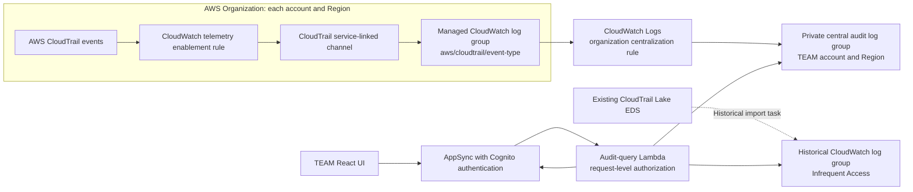

# CloudTrail Lake to Amazon CloudWatch Migration Analysis

## Executive summary

Temporary Elevated Access Management (TEAM) uses CloudTrail Lake only as the storage and query engine behind the **Session activity logs** panel. CloudTrail Lake is not involved in approving requests, granting or revoking IAM Identity Center assignments, running Step Functions workflows, or recording approval history.

CloudTrail Lake is closed to new customers starting May 31, 2026. Existing customers can continue using it, although AWS states that the feature will receive only critical bug fixes and security updates. AWS recommends migrating Lake data to the Amazon CloudWatch unified data store. CloudTrail itself remains supported. See [CloudTrail Lake availability change](https://docs.aws.amazon.com/awscloudtrail/latest/userguide/cloudtrail-lake-service-availability-change.html).

“CloudWatch Unified” is not a separate service API or SDK. For TEAM, the replacement consists of:

- CloudWatch Observability Admin for organization telemetry enablement and centralization.
- CloudWatch Logs for storage and Logs Insights queries.
- CloudTrail service-linked channels as the live event source.
- Optionally, CloudWatch pipelines and OCSF normalization. TEAM does not require these for the initial migration.

The runtime migration is localized to two Lambda functions, one custom infrastructure component, the session-query state model, and the activity-log API and UI. The IAM Identity Center access workflow can remain unchanged.

## Current use of CloudTrail Lake

| Responsibility | Current implementation |
|---|---|
| Organization-wide collection | `AWS::CloudTrail::EventDataStore` in `amplify/backend/custom/cloudtrailLake/cloudtrailLake-cloudformation-template.json` |
| Region coverage | `MultiRegionEnabled: true` |
| Account coverage | `OrganizationEnabled: true`, except in the `aws-cn` partition |
| Retention | Hard-coded to seven days |
| Event selection | Management events only; optionally read-only, write-only, or both |
| Query initiation | `teamgetLogs` calls CloudTrail Lake `StartQuery` |
| Query completion | `teamgetLogs` repeatedly calls `DescribeQuery` |
| Query retrieval | `teamqueryLogs` calls and paginates `GetQueryResults` |
| Query-state cache | The `sessions` DynamoDB table stores the Lake query ID |
| Presentation | React displays four fields and supports client-side CSV download |

### Event data store

The custom CloudFormation resource is defined at `amplify/backend/custom/cloudtrailLake/cloudtrailLake-cloudformation-template.json:1-171`.

It accepts one of the following `CloudTrailAuditLogs` values:

- `read`: read-only management events.
- `write`: write management events.
- `read_write`: all management events.
- `none`: create an event data store with ingestion disabled.
- An ARN: use an existing event data store instead of creating one.

When TEAM creates the event data store, it configures:

- Organization-wide event ingestion.
- Multi-Region ingestion.
- Seven-day retention.
- No data events by default.
- No termination protection.

The repository currently has conflicting defaults:

- `amplify/backend/custom/cloudtrailLake/parameters.json` specifies `read`.
- An empty top-level deployment parameter becomes `read_write` in `deployment/template.yml`.

The migration should replace this ambiguity with an explicit configuration enum.

### Session-event correlation

The effective query is constructed in `amplify/backend/function/teamgetLogs/src/index.js:136-152`:

```sql
SELECT eventID, eventName, eventSource, eventTime
FROM <event-data-store>
WHERE eventTime > '<start-time>'
  AND eventTime < '<end-time>'
  AND lower(useridentity.principalId) LIKE '%:<username>%'
  AND useridentity.sessionContext.sessionIssuer.arn LIKE '%<role>%'
  AND recipientAccountId = '<account-id>'
```

The query correlates events to a TEAM request through:

1. The request's audit time window.
2. The target AWS account.
3. The requester’s IAM Identity Center role-session name.
4. The IAM Identity Center permission-set role ARN.

CloudTrail events do not contain a TEAM request ID. Correlation is therefore based on **user + account + permission set + time range**, rather than on a unique request identifier. If the same user accesses the same account and permission set through overlapping paths, TEAM cannot determine which assignment enabled a particular event.

### Query lifecycle

1. A requester, approver, or auditor expands the activity-log panel.
2. `src/components/Sessions/Logs.js:168-204` creates a `sessions` record through AppSync.
3. The browser supplies the start time, end time, username, account ID, and role.
4. A DynamoDB INSERT stream invokes `teamgetLogs`.
5. `teamgetLogs` starts the Lake SQL query and waits for it to finish.
6. It writes the query ID to the `sessions` record using a signed AppSync mutation.
7. An AppSync subscription notifies the browser.
8. The browser calls the `getLogs(queryId)` GraphQL resolver.
9. `teamqueryLogs` retrieves all Lake query-result pages.
10. The React component adds display-only username and account metadata and can export the rows as CSV.

For an active request, the end of the query window is the current time. For an ended request, `Logs.js:198-201` adds one hour to the recorded end time. This compensates for IAM Identity Center credentials that can remain valid after TEAM removes the account assignment.

The `sessions` DynamoDB table does not store CloudTrail events. It stores transient query state and the query ID. Queries are started lazily only when someone opens the activity-log panel.

### Data exposed by TEAM

Although the event data store contains complete CloudTrail records, TEAM projects and displays only:

- `eventID`
- `eventName`
- `eventSource`
- `eventTime`

The GraphQL type is defined at `amplify/backend/api/team/schema.graphql:265-270`, and the React columns are defined at `src/components/Sessions/Logs.js:25-54`.

TEAM does not expose the source IP address, AWS Region, user agent, error details, request parameters, response elements, affected resources, or the complete CloudTrail event. The current panel is therefore a compact activity list rather than a complete forensic interface.

### Components that do not depend on CloudTrail Lake

The following functionality remains independent of the migration:

- Request creation and approval history in DynamoDB.
- IAM Identity Center account-assignment creation and deletion.
- Approval, scheduling, grant, rejection, and revocation state machines.
- Email and Slack notifications.
- Eligibility and approver policies.
- AppSync operational logging through `custom/appsyncCloudwatchLogRole`.

CloudTrail Lake is also not used for Lake dashboards, scheduled queries, integrations, channels, or non-AWS event ingestion.

## Existing audit-subsystem findings

A direct SDK substitution would retain important security, correctness, and operability problems. These should be addressed in the migration.

### Client-controlled audit criteria

`src/components/Sessions/Logs.js:168-178` sends the username, account, role, and time range from the browser. `teamgetLogs` interpolates them directly into SQL at `amplify/backend/function/teamgetLogs/src/index.js:144`.

Consequences include:

- Query injection risk.
- A caller potentially requesting activity outside the canonical TEAM request.
- Trusting display/client state for audit attribution.

The new resolver must accept a request ID only, load the canonical request server-side, validate it, and derive all query criteria from that record.

### Insufficient result authorization

`getLogs(queryId)` is available to any authenticated user at `amplify/backend/api/team/schema.graphql:384-388`. The resolver does not verify that the query belongs to a request the caller owns, may approve, or may audit.

The replacement must bind every query ID to its TEAM request and perform action-level authorization for each start, status, and result request.

### Incorrect subscription scoping

The generated subscription accepts an `$id` argument, but `src/components/Sessions/Logs.js:228-233` supplies a `filter` object. This can result in an unscoped subscription receiving updates for unrelated query records.

Combined with the broadly authenticated `getLogs(queryId)` resolver, this can expose activity from another request. The recommended API removes this subscription and uses an authorized status-polling operation.

### DynamoDB stream batch loss

`amplify/backend/function/teamgetLogs/src/index.js:155` processes only `event.Records.pop()`. The event-source mapping permits batches of up to 100 records, so the remaining records in a batch can be ignored.

### Unbounded polling

`teamgetLogs` calls `DescribeQuery` continuously without delay. It exits only for `FINISHED`; failed, cancelled, or timed-out statuses can loop until the Lambda timeout. The replacement should expose query status to the client and use bounded polling with backoff.

### Sensitive audit data in operational logs

The two audit Lambdas log session criteria and complete result arrays. The migration should retain only structured operational fields such as request ID, query ID, status, duration, and result count. It should not duplicate CloudTrail activity into Lambda logs.

### Fragile historical behavior

The internally created event data store retains only seven days. The cached `sessions` item lasts five days after query creation. A query can become stale if it runs before delayed CloudTrail events arrive, and an expired CloudTrail query ID can remain in DynamoDB without automatic recovery.

### Incorrect fixed credential extension

The UI adds a fixed one hour to ended requests, although `teamRouter` already stores the permission set's authoritative `SessionDuration` in `requests.session_duration` at `amplify/backend/function/teamRouter/src/index.py:481-494`.

The replacement should parse and apply the stored ISO 8601 session duration. It should use a documented fallback only when the field is absent.

### Imprecise permission-set matching

The current substring match can confuse permission-set names such as `Admin` and `AdminReadOnly`. The replacement should validate the permission-set name and match the complete generated `AWSReservedSSO_<permission-set>_<suffix>` role-name structure.

### Limited event coverage

TEAM captures management events only. Data-plane activity such as S3 object access or DynamoDB item operations is generally absent unless corresponding data events are enabled separately. The migration must preserve this behavior intentionally or explicitly expand scope after a cost and compliance review.

## Recommended target architecture



### Separate audit-infrastructure lifecycle

The current EDS belongs to the Amplify application stack and has termination protection disabled. Deleting an Amplify environment can consequently delete its audit source.

The recommended arrangement is:

- A separate organization-level stack owns telemetry enablement, centralization, retention, and encryption.
- TEAM consumes the central log-group ARN and audit Region as deployment parameters.
- Existing enterprise CloudWatch centralization can be reused rather than duplicated.
- Removing TEAM does not remove organization-wide audit collection.
- The runtime Lambda receives only CloudWatch Logs query permissions, not organization-administration permissions.

## Infrastructure migration

### Enable organization telemetry configuration

From the AWS Organizations management account or a registered CloudWatch delegated administrator:

1. Enable CloudWatch telemetry configuration.
2. Designate the intended delegated administrator and destination account.
3. Enable every required Region, preferably all supported Regions.
4. Confirm that the Observability Admin service-linked roles are healthy.

The programmatic onboarding operation is:

```shell
aws observabilityadmin start-telemetry-evaluation-for-organization --all-regions
```

CloudWatch telemetry discovery and remediation can take up to 24 hours, so it must be enabled before the planned cutover. See [organization telemetry setup](https://docs.aws.amazon.com/AmazonCloudWatch/latest/monitoring/telemetry-config-organization.html).

### Create an organization telemetry rule

Use `AWS::ObservabilityAdmin::OrganizationTelemetryRule` or `create-telemetry-rule-for-organization` with the following logical configuration:

- Resource type: `AWS::CloudTrail`.
- Telemetry type: `Logs`.
- Destination type: `cloud-watch-logs`.
- Scope: the complete organization or the intended OUs/accounts.
- Regions: all Regions used by workloads, including Regions receiving global-service events.
- Retention: an explicit, configurable value derived from audit requirements.
- Advanced event selectors equivalent to the selected TEAM audit mode:
  - `eventCategory = Management`.
  - Optionally `readOnly = true` or `readOnly = false`.

CloudWatch uses a service-linked channel and managed log groups named using `aws/cloudtrail/<event-types>`. Existing customer-created CloudTrail trails remain unchanged. See [telemetry enablement rules](https://docs.aws.amazon.com/AmazonCloudWatch/latest/monitoring/telemetry-config-rules.html).

### Create an organization centralization rule

Direct ingestion places managed log groups in each source account and Region. TEAM requires a central query location, so use `AWS::ObservabilityAdmin::OrganizationCentralizationRule` to:

- Select the organization or intended OUs/accounts.
- Include every source Region enabled by the telemetry rule.
- Select only source groups matching `aws/cloudtrail/%`.
- Copy the events to the TEAM or log-archive account.
- Select a destination Region accessible to the audit-query Lambda.
- Configure encryption behavior for source and destination groups.

Centralization handles only events arriving after the rule is created. Create the centralization rule before enabling live ingestion where possible. See [cross-account and cross-Region log centralization](https://docs.aws.amazon.com/AmazonCloudWatch/latest/logs/CloudWatchLogs_Centralization.html).

For TEAM, a pre-created static destination such as `/aws/team/cloudtrail-management` is attractive because:

- The Lambda queries one explicit log group.
- IAM permissions can be restricted to one log-group ARN where supported.
- Retention and KMS encryption can be configured before events arrive.
- `recipientAccountId` and `awsRegion` remain in each CloudTrail event.

For organizations requiring source separation, use a destination pattern containing `${source.accountId}`, `${source.region}`, and `${source.logGroup}`. The Lambda can then select groups by a dedicated prefix through the Logs Insights `SOURCE` command.

### Preserve raw CloudTrail schema initially

Do not add OCSF transformation to the first migration. TEAM depends on the raw fields:

- `eventID`
- `eventName`
- `eventSource`
- `eventTime`
- `recipientAccountId`
- `userIdentity.principalId`
- `userIdentity.sessionContext.sessionIssuer.arn`

CloudWatch supports optional OCSF normalization, but introducing it concurrently would require another query and response-schema migration. It can be adopted later if TEAM needs correlation across security and operational data sources.

## Runtime query migration

### API mapping

| CloudTrail Lake | CloudWatch replacement |
|---|---|
| `CloudTrailClient` | `CloudWatchLogsClient` |
| `StartQueryCommand({ QueryStatement })` | `StartQueryCommand({ logGroupName, startTime, endTime, queryString, queryLanguage: "CWLI" })` |
| `DescribeQueryCommand` | `GetQueryResultsCommand` and its `status` field |
| `FINISHED` | `Complete` |
| Lake terminal failure statuses | `Failed`, `Cancelled`, `Timeout`, and `Unknown` |
| `EventDataStore` | Central log-group name or ARN plus audit Region |
| `QueryResultRows` | `results`, represented as arrays of `{ field, value }` |
| Lake result pagination | CloudWatch `nextToken` pagination |

CloudWatch `StartQuery` accepts the time range as epoch seconds, so timestamps no longer need to be interpolated into query text. `GetQueryResults` returns partial rows while a query is `Scheduled` or `Running`. CloudWatch supports up to 10,000 results per response and up to 100,000 results from a paginated Logs Insights QL query. See [StartQuery](https://docs.aws.amazon.com/AmazonCloudWatchLogs/latest/APIReference/API_StartQuery.html) and [GetQueryResults](https://docs.aws.amazon.com/AmazonCloudWatchLogs/latest/APIReference/API_GetQueryResults.html).

A candidate Logs Insights query for raw CloudTrail events is:

```text
parse userIdentity.principalId "*:*" as rolePrincipalId, sessionName
| filter recipientAccountId = "123456789012"
| filter tolower(sessionName) = "user@example.com"
| filter userIdentity.sessionContext.sessionIssuer.arn like "AWSReservedSSO_RequestedPermissionSet_"
| sort eventTime asc
| dedup eventID
| fields eventID, eventName, eventSource, eventTime
| limit 10000
```

The account ID, username, role marker, and timestamps must be obtained from the canonical request record. Dynamic values must be validated and escaped server-side. A pilot must confirm that live and imported records expose the expected raw field names.

### Recommended GraphQL contract

The existing `[Logs] getLogs(queryId)` response cannot represent running, failed, timed-out, or paginated queries. Replace it with an asynchronous contract such as:

```graphql
type AuditQuery {
  queryId: ID!
  requestId: ID!
  status: String!
}

type AuditLogPage {
  queryId: ID!
  status: String!
  events: [Logs!]!
  nextToken: String
  errorCode: String
}

type Mutation {
  startSessionActivityQuery(requestId: ID!): AuditQuery!
}

type Query {
  sessionActivity(queryId: ID!, nextToken: String): AuditLogPage!
}
```

`startSessionActivityQuery` should:

1. Load the request by ID.
2. Verify that the caller is the requester, an authorized approver, or an Auditor.
3. Derive the account, permission set, requester, start time, and effective end time.
4. Start the CloudWatch query.
5. Store a server-owned association between request ID, query ID, authorization scope, and expiration.

`sessionActivity` should:

1. Verify that the query belongs to a request accessible to the caller.
2. Call `GetQueryResults`.
3. Return explicit status, rows, a safe error code, and `nextToken`.
4. Convert each result row from `{ field, value }` pairs into the existing `Logs` object.

The browser should poll with bounded backoff while the query is `Scheduled` or `Running`. This removes the DynamoDB stream trigger, the broad AppSync subscription, and the Lambda busy loop. CloudWatch credentials remain exclusively on the Lambda execution role.

A minimal compatibility migration could retain the current `sessions` table and GraphQL response shape, but it would preserve the authorization and subscription defects and is not recommended.

## Historical-data migration

AWS supports importing an existing Lake event data store into CloudWatch through the CloudTrail console or the CloudWatch Logs import API:

```shell
aws logs create-import-task \
  --import-source-arn "<event-data-store-arn>" \
  --import-role-arn "<migration-role-arn>" \
  --import-filter '{"startEventTime": <epoch>, "endEventTime": <epoch>}'
```

Important characteristics:

- Perform a small pilot import first.
- Imported data uses an Infrequent Access log group named `aws/cloudtrail/<event-data-store-id>`.
- There is no additional CloudTrail ingestion charge for the simplified export, but CloudWatch storage charges apply.
- Data before 2023 cannot be imported through this mechanism. Retain Lake access or export older records to S3 if required.
- Historical import and live centralization are separate paths.
- An overlap window can contain duplicates; deduplicate by `eventID`.

See [historical Lake-to-CloudWatch migration](https://aws.amazon.com/blogs/mt/aws-cloudtrail-lake-import-historical-data-to-amazon-cloudwatch/) and [export documentation](https://docs.aws.amazon.com/awscloudtrail/latest/userguide/cloudtrail-lake-export-cloudwatch.html).

## Cutover strategy

1. Record a proposed cutover timestamp.
2. Enable organization telemetry configuration well before cutover.
3. Pilot the telemetry and centralization rules with a limited account or OU and representative Regions.
4. Run a controlled TEAM session with known read and write management API calls.
5. Compare Lake and CloudWatch using event IDs, account, role, user, timestamps, and counts.
6. Add the CloudWatch runtime behind an `AUDIT_BACKEND` feature flag while retaining Lake for rollback.
7. Export a small historical window and validate its schema and query behavior.
8. Export the remaining required history.
9. Run Lake and CloudWatch concurrently for at least one day to cover delayed events.
10. Switch TEAM to CloudWatch after parity and authorization tests pass.
11. Disable Lake ingestion only after validation and audit-owner approval.
12. Delete the EDS and remove now-unused CloudTrail delegated administration only as a separate, explicitly approved production cleanup.

## Required project changes

| Area | Required change |
|---|---|
| `amplify/backend/custom/cloudtrailLake/` | Retain during dual-run. Add a separate CloudWatch audit consumer configuration or external organization stack. Remove the EDS only after cutover. |
| `amplify/backend/backend-config.json` | Add CloudWatch audit outputs and dependencies; retain Lake dependencies during transition. |
| `amplify/backend/function/teamgetLogs/src/index.js` | Replace Lake query initiation; preferably replace the stream handler with an authenticated start-query resolver. |
| `amplify/backend/function/teamqueryLogs/src/index.js` | Use CloudWatch `GetQueryResults`, map `{ field, value }`, handle every status and pagination, and stop logging event contents. |
| Audit Lambda package manifests | Replace `@aws-sdk/client-cloudtrail` with an exactly pinned `@aws-sdk/client-cloudwatch-logs` and regenerate lock files. |
| Audit Lambda CloudFormation | Replace `EVENT_DATA_STORE` with central log-group and audit-Region settings. |
| Audit Lambda IAM | Replace `cloudtrail:StartQuery`, `cloudtrail:DescribeQuery`, and `cloudtrail:GetQueryResults` with least-privilege CloudWatch Logs query permissions. |
| `amplify/backend/api/team/schema.graphql` | Introduce typed query status and pagination and require a request ID when starting an audit query. |
| `src/components/Sessions/Logs.js` | Stop sending query criteria; use request IDs, status polling, errors, server pagination, and the real permission-set session duration. |
| `src/components/Shared/RequestService.js` | Add typed start/status/result operations and remove direct session-query record mutation from the browser. |
| `parameters.js` | Replace `CLOUDTRAIL_AUDIT_LOGS` with CloudWatch consumer parameters and remove the duplicate `update_cloudtrail_parameters` definition at lines 119-151. |
| `deployment/init.sh` | Bootstrap CloudWatch telemetry configuration and delegated administration and use fail-fast shell behavior instead of `set +e`. |
| `deployment/template.yml`, `deploy.sh`, `update.sh`, and parameter templates | Add audit Region, log-group ARN, backend mode, event mode, retention, and optional KMS parameters. |
| Generated Amplify files | Regenerate dependent-resource types and GraphQL operations rather than editing them manually. |
| Product documentation and `ToolsDrawer.js` | Replace Lake prerequisites, costs, architecture, delegated-administration, and retention guidance. |
| Tests | Add tests; neither audit Lambda currently has a working test suite. |

`amplify/backend/custom/appsyncCloudwatchLogRole` must remain. It controls AppSync operational logging and is unrelated to the CloudTrail audit datastore.

## Security and IAM requirements

- Keep all source and centralized log groups private.
- Do not grant direct CloudWatch access to browsers.
- Separate organization-administration permissions from Lambda runtime permissions.
- Restrict `logs:StartQuery` to the designated central log group where supported.
- Permit `logs:GetQueryResults` only on the audit-query Lambda role and bind query IDs to authorized TEAM requests in application state.
- If customer-managed KMS keys are used, configure both CloudWatch Logs and centralization service access explicitly and validate each Region.
- Return generic client errors while logging structured diagnostic context without usernames, account IDs, event contents, or query text.
- Test anonymous and unrelated-user denial before enabling the new backend.

## Cost and service-limit considerations

CloudWatch introduces the following cost dimensions:

- Live CloudTrail event ingestion into source-account CloudWatch log groups.
- Storage in each source account.
- Centralized destination storage.
- Additional centralization copies if configured.
- Logs Insights data scanned by each query.
- Infrequent Access storage for imported historical Lake data.

Cost controls include:

- Management events only unless data events are explicitly required.
- A retention period aligned to audit requirements rather than unlimited retention.
- Narrow server-derived time windows.
- A single central log group or tightly scoped log-group prefix.
- Equality filters and field indexes where supported.
- Query-result caching that can be safely refreshed for delayed events.

Relevant operational constraints include:

- CloudWatch Logs Insights queries time out after 60 minutes.
- Logs Insights QL supports up to 100 concurrent queries per Region/account.
- Explicit `StartQuery` requests support up to 50 log groups; `SOURCE` can select larger sets by prefix.
- Each result page contains up to 10,000 events.
- Logs Insights QL can paginate up to 100,000 results.
- Centralization copies only new events arriving after rule creation.
- Telemetry configuration discovery can take up to 24 hours.

## Validation and acceptance criteria

The migration is complete only after validating:

- Read-only, write-only, and read/write management-event modes.
- Events from every required account and Region.
- Active-session refresh behavior.
- Ended-session queries through the actual permission-set credential lifetime.
- Delayed CloudTrail event arrival and safe query refresh.
- Empty, running, complete, failed, cancelled, timed-out, and unknown statuses.
- More than 10,000 events and continuation-token pagination.
- Deduplication across live and historical paths.
- Exact permission-set matching for overlapping names.
- Requester, authorized approver, and Auditor access.
- Anonymous, unrelated-user, and unrelated-approver denial.
- Retention, KMS policy, and centralization health.
- Event-ID parity between Lake and CloudWatch for the pilot window.
- No full audit events or sensitive query criteria in Lambda logs.

## Recommendation

Do not implement this as only an SDK replacement. Replace the audit datastore while also moving query construction and authorization fully to the backend. Deploy the organization-level CloudWatch infrastructure independently, migrate historical data through a pilot, run both systems in parallel, and remove CloudTrail Lake only after measured event parity and authorization validation.

AWS documentation referenced in this analysis was paraphrased.